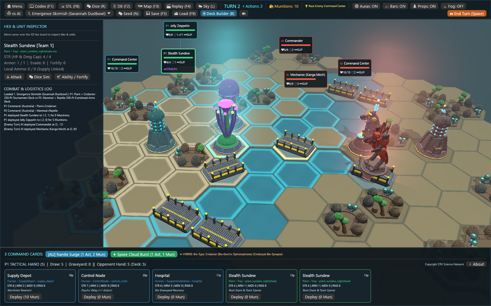

# WildFront BattleGrounds (`v3.4.1`)

[](https://www.gnu.org/licenses/gpl-3.0)



> *"The year is 2072. Only six continents remain. The earth has been wracked by global warming, drought, and radiation following years of nuclear war. Humanity has retreated into underground bunkers along with a handful of surviving plants and animals..."*

**WildFront BattleGrounds** is a native Rust (`GPL-3.0-or-later`) hexagonal ecological tactics game and deterministic simulation workbench built on `wgpu 30.0`, `winit 0.30`, `egui 0.37`, `hexx 0.19`, `bevy_ecs 0.15`, `rusqlite 0.32`, and `kira 0.12`.

---

## Core Architecture & Features (`v3.4.1`)

- **152 Balanced Cards & 170 Sparse 64-Tree Voxel Rigs**:
  - Compiled from `data/Wildfront_PC_Master_Stats_and_DeckBuilder.xlsx` (`113` bio/combat units + `13` support installations + `26` tactical deployments & artifacts = `152` cards, Pearson cost-vs-utility `r = 0.998889`) and paired with `170` compiled Sparse 64-Tree rigs (`152` card models + `12` terrain hexes + `6` terrain props; `10,039,096` non-empty voxels in `589,863` `Brick64` leaves and `47,712,512` bytes of GPU SVO memory — `8.89x` byte compression).
  - Covers `10` Organism Lineages (`Human` Core Infrastructure + `Mammal`, `Reptile`, `Plant`, `Bird`, `Arachnid`, `Insect`, `Fish`, `Cnidarian`, `Amphibian`) and `6` Continental Allegiances (`Australia`, `Africa`, `Asia`, `Europe`, `North America`, `South America`).
- **GPU Compute Sparse 64-Tree Raymarcher (`crates/wf_client/src/shaders/raymarch_64tree.wgsl`)**:
  - `8×8` workgroup ray-cone tile culling (`wg_tile_insts`), 4-level `[0..256]^3` DDA traversal with hardware `countOneBits` popcnt child indexing, world-space normal reconstruction, generalized 8-tap X/Y/Z tangent-plane voxel crevice ambient occlusion, 6-step binary-search hex terrain surface refinement, Schlick Fresnel team-tinted rim shading, animated water reflections, volumetric voxel/beam VFX debris, and 4 dynamic atmosphere presets (`L`).
- **Tactical Logistics, Combat & Multi-Mode Play (`crates/wf_core`, `crates/wf_sim`)**:
  - **Logistics Graphs**: Turn-1 asymmetry (`P1`: 5 Munitions / 5 cards / 2 Actions; `P2`: 8 Munitions / 6 cards / 2 Actions), contiguous BFS Home Supply chains (`🔗SUP`), Psychic Control Node leashes (`2 + min(static_Control_Nodes, 3)` Actions/turn), Hospital/Factory graveyard recovery, and Round 30+ Orbital Fallout Storm.
  - **D6 Combat & Exact Analytical EV**: Strength-invariant `DmgD6` capped by attacker `STR`, dynamic `effective_evade` preserving immutable printed `evade` across `Blind`/`Rooted` statuses, and exact `36`-outcome / `216`-outcome Expected Value evaluation (`compute_attack_ev`) for `Veteran (1-Ply EV Focus)` alongside `Recruit` and beam-pruned `Grandmaster (2-Ply Lookahead)`.
  - **Multiplayer & Persistence**: Solo vs AI, 1v1 Local Hotseat (`M`) with Fog-of-War handoff privacy curtain, 1v1 TCP Lockstep (`0.0.0.0:20720` / `127.0.0.1:20720`) with `SplitMix64` RNG & 64-bit FNV-1a replay hashing, and `.ron` Quicksave/Quickload (`F5`/`F9`).
- **Unified In-Game Studios & 250-Pt Deck Builder (`crates/wf_client`)**:
  - Compact top HUD **`🛠 Studios ▾`** menu (`F8` Watertight `45.0 mm` tabletop `.STL` export with recessed 45° micro-dice V-cradles, `F2` SQLite Roster DB Manager, `F3` 3D Hex Map & Scenario Studio with rotational/mirror symmetry brushes, `F4` Replay Scrubber & EHP Telemetry Theater, `R` Interactive Dice Simulator), plus **`B` Deck Builder**, **`F1` Field Manual Codex**, bounded camera panning (`WASD`/Arrows + `Home`/`C` reset), and End Turn confirmation when `actions_remaining > 0`.
- **3D Spatial Combat Audio (`crates/wf_client/src/audio.rs`)**:
  - `kira 0.12.6` spatial stereo panning and distance rolloff across 8 synthesized 44.1 kHz 16-bit PCM `.wav` sound effects (`assets/sfx/*.wav`) with live mute and dB gain controls.

---

## Workspace Crates

| Crate | Purpose |
|:------|:--------|
| [`wf_core`](crates/wf_core) | Roster schema (`STAT_WEIGHTS_TENTHS`), axial `hexx` terrain & clamped `SplitMix64`/FBM mapgen, BFS supply & node logistics, D6 combat mechanics, abilities, Sparse 64-Tree SVO compiler, and SQLite DB loader |
| [`wf_assets`](crates/wf_assets) | Excel `.xlsx` compiler, binary MagicaVoxel `.vox` baker, scenario `.ron` exporter, and watertight 2-manifold tabletop `.STL` generator with recessed micro-dice V-cradles |
| [`wf_sim`](crates/wf_sim) | Deterministic headless simulator (`HeadlessMatch`), FNV-1a replay verifier, exact analytical EV (`Veteran`) & 2-ply minimax (`Grandmaster2Ply`) AI planners, and 102-match tournament CLI |
| [`wf_client`](crates/wf_client) | Native `wgpu` 64-Tree raymarched desktop client, `egui 0.37` tactical HUD, Deck Builder, 5 Studios, `kira` spatial audio, TCP lockstep netcode, and headless PNG `--screenshot` renderer |

---

## Quick Start & CLI Usage

### Build & Run Desktop Client
```bash
cargo run -p wf_client --release
```

One-command test + build + launch scripts:
- **Linux / macOS**: `./scripts/verify_and_run.sh`
- **Windows PowerShell**: `.\scripts\verify_and_run.ps1`

### `wf_client` CLI Flags
```bash
wf_client --help
wf_client --version
wf_client --screenshot out.png --screenshot-view 1   # Views: 1=Arena, 2=Deck Builder, 3=Map Studio
```

### `wf_sim` Headless Simulator & Tournament CLI
```bash
# Single deterministic match + replay export
cargo run -p wf_sim --release -- match \
  --p1-origin Australia --p1-primary Mammal --p1-secondary Mammal \
  --p2-origin Africa --p2-primary Fish --p2-secondary Fish \
  --scenario 4 --seed 544344084 --ai grandmaster --save-replay replays/sample.ron

# Bit-exact 64-bit FNV-1a replay hash verification
cargo run -p wf_sim --release -- verify-replay replays/sample.ron

# Full 102-match Pure Bio-Type + Continental Round-Robin Tournament
cargo run -p wf_sim --release -- tournament --ai veteran --max-rounds 45 --export-ron reports/tournament_102.ron
```

### `wf_assets` Asset & `.STL` Compiler CLI
```bash
cargo run -p wf_assets --release -- \
  --xlsx data/Wildfront_PC_Master_Stats_and_DeckBuilder.xlsx \
  --vox-dir assets/vox \
  --out-dir assets/compiled \
  --seed 20720814 \
  --export-stl --hex-mm 45.0 --center-wall-mm 2.80
```

---

## Controls & Hotkeys

| Input | Action |
|:------|:-------|
| **Left Click** | Select hex/unit, deploy selected hand card, move, attack, or trigger ability (paints hexes in `F3` Map Studio) |
| **Left / Right Drag** | Orbit 3D camera around the battlefield |
| **Scroll Wheel** | Smooth camera zoom (`3.2`–`68.0` distance) |
| **`WASD` / Arrow Keys** | Pan camera target (clamped to active battlefield bounds) |
| **`Home` / `C`** | Reset camera position, orbit yaw/pitch, and zoom to tactical overview |
| **`Space`** | End Turn (opens confirmation prompt when `Actions > 0`), reveal Hotseat privacy curtain, or roll dice in `R` Simulator |
| **`B`** | Toggle 250-Point Two-Faction Deck Builder |
| **`F1` / `Esc`** | Toggle 4-tab Field Manual Codex (`F1`) / Dismiss top modal or open Main Menu (`Esc`) |
| **`F8` / `F2` / `F3` / `F4` / `R`** | Open `.STL` Print Studio / SQLite DB Manager / Hex Map Studio / Replay & EHP Theater / Dice Simulator (also under `🛠 Studios ▾`) |
| **`L` / `Tab` / `H` / `P` / `F`** | Cycle GPU sky presets / Supply & Node auras / 3D HP bars / Terrain props / Fog-of-War |
| **`M` / `F5` / `F9` / `1`–`5` / `N`** | Toggle Solo AI vs Hotseat / Quicksave / Quickload (`saves/quicksave.ron`) / Scenarios `1`–`5` / Roll new seed |

---

## Testing & Empirical Validation (`v3.4.1`)

Run the full workspace verification and cross-platform CI suite:
```bash
cargo check --workspace --all-targets
cargo test --workspace
```

Deterministic empirical telemetry generated by `cargo test -p wf_sim --test headless_validation` (`validation/wildfront_validation_summary.json`):
- **T1 (`t1_hex_determinism_replay`)**: `160` axial symmetry checks, `720` terrestrial water blocks / `720` aquatic passes, and `3` full replays (`237` verified steps) matching exact final 64-bit FNV-1a hashes (`0x8e68eb4b68ff3955`, `0x2f5a2d53af14d3ff`, `0x4dd419d75ded337b`).
- **T2 (`t2_deck_audit_and_round_robin`)**: `152` cards audited at **`r = 0.998889`** (`cost` vs `weighted_utility`), plus `102`-match `Veteran (1-Ply EV Focus)` round-robin tournament achieving **`83 / 102` decisive matches** (`55` P1 wins, `28` P2 wins, median `14.0` turns, `38,293.80 ms`).
- **T3 (`t3_svo_64tree_raymarching`)**: `170` Sparse 64-Tree rigs (`10,039,096` non-empty voxels packed into `47,712,512` bytes, **`8.89x`** dense-to-SVO byte compression, **`266,612.2` rays/s** debug CPU DDA throughput, `48/48` exterior AABB misses verified).

Verify cross-platform workspace targets and suites locally with `cargo check --workspace --all-targets` and `cargo test --workspace`.

---

## Documentation

- [**User Guide (`docs/USER_GUIDE.md`)**](docs/USER_GUIDE.md) — Controls, top HUD & Studios workflows, Deck Builder, multiplayer setup, and `wf_sim` / `wf_assets` CLI reference
- [**Scientific & Algorithmic Methods (`docs/SCIENTIFIC_METHODS.md`)**](docs/SCIENTIFIC_METHODS.md) — Sparse 64-Tree DDA math, world-space normals, 8-tap X/Y/Z crevice AO, binary-search hex refinement, Fresnel shading, BFS supply chains, and exact D6 Expected Value equations
- [**Validation Telemetry (`validation/README.md`)**](validation/README.md) — T1/T2/T3 verification protocol and balance CSV outputs
- [**Code Review Guide (`CODE_REVIEW_GUIDE.md`)**](CODE_REVIEW_GUIDE.md) — Architecture map and engineering invariants

---

## Citation & CRV Science Apps Hub

- **CRV Science Apps Hub**: [https://crvscience.com/apps](https://crvscience.com/apps)
- **Companion Preprint (`APP-PREPRINT-12`)**: *WildFront BattleGrounds: Turn-Based Hex Strategy Game with Voxel Graphics and Procedural Map Generation* — [https://crvscience.com/apps/preprints/wildfront-hexagonal-ecological-tactics](https://crvscience.com/apps/preprints/wildfront-hexagonal-ecological-tactics)
- **Concept DOI**: [10.5281/zenodo.24222396](https://doi.org/10.5281/zenodo.24222396)
- **Repository**: [https://github.com/bpwhite/crvscience-wildfront-game](https://github.com/bpwhite/crvscience-wildfront-game)
- **Citation Metadata**: [CITATION.cff](CITATION.cff)

```bibtex
@article{white2026wildfront,
  author  = {White, Bryan P.},
  title   = {WildFront BattleGrounds: Turn-Based Hex Strategy Game with Voxel Graphics and Procedural Map Generation},
  journal = {CRV Science Apps Preprints},
  year    = {2026},
  doi     = {10.5281/zenodo.24222396},
  url     = {https://crvscience.com/apps/preprints/wildfront-hexagonal-ecological-tactics},
  note    = {Preprint ID: APP-PREPRINT-12; Software version 3.4.1}
}
```
